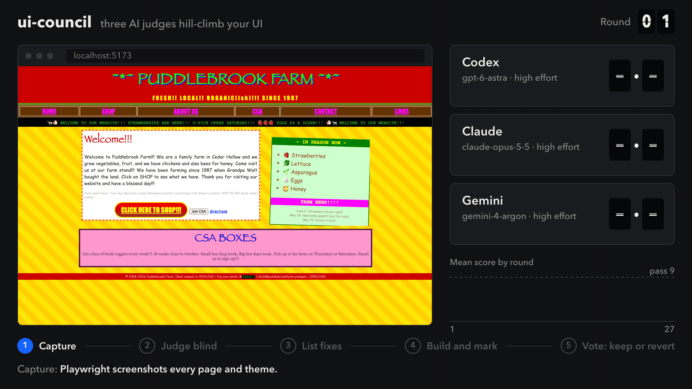
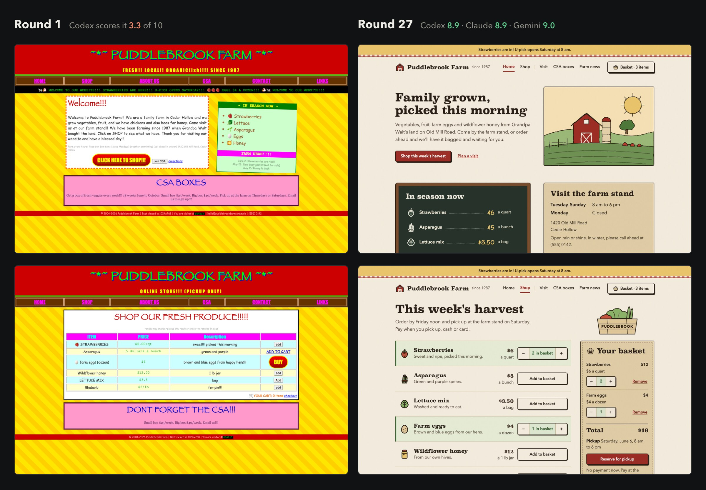
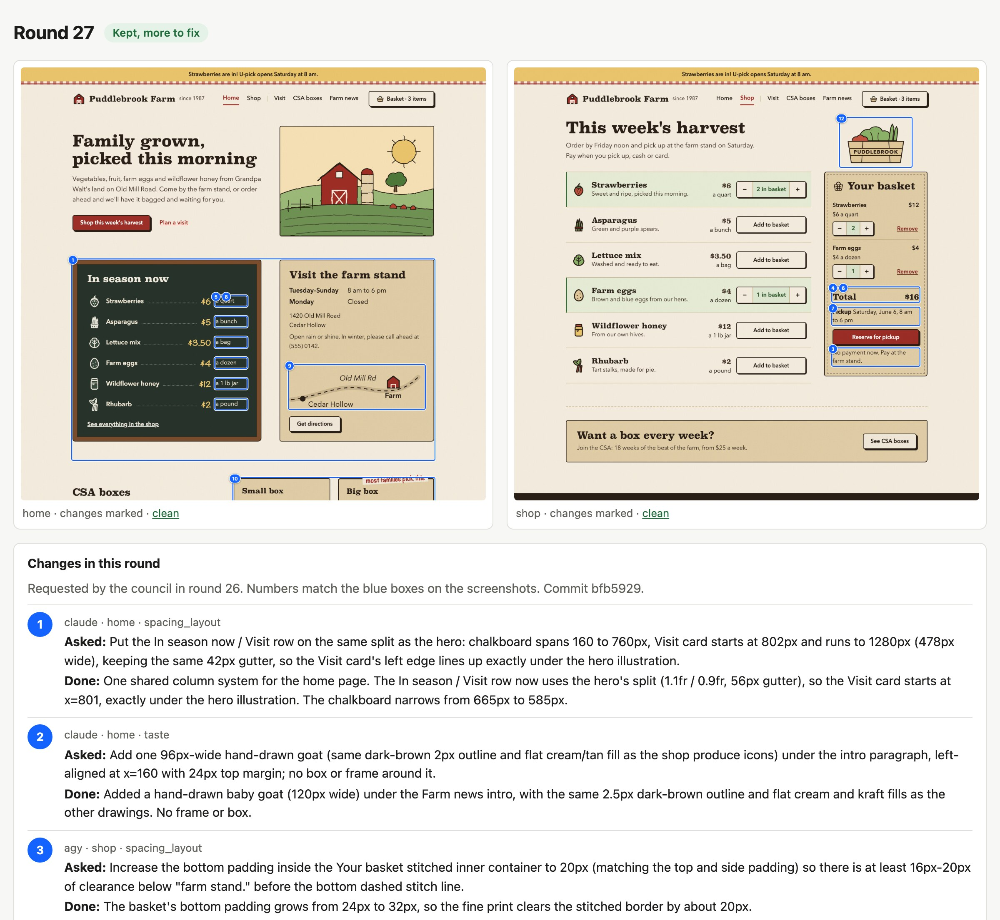

# ui-council

A [Claude Code](https://claude.com/claude-code) skill that hill-climbs your web app's UI. Three AI judges (Codex, Claude and Gemini) score your screens blind, list exact fixes, and vote on whether each round is better than the last. Claude makes the changes. Rounds the judges call worse are reverted.



<sub>Real screenshots from a 27-round run on a demo farm site. The scores in the animation are simplified.</sub>

## Before and after



Same site, same content, same design language. Round 1 was a deliberately bad starting point. By round 27, all three judges scored it 8.9 to 9.0 out of 10, and every objective check passed.

## How a round works

1. **Capture.** Playwright screenshots every screen in every theme. Objective checks run on the live page: contrast, horizontal overflow, and how many font sizes, families, weights and corner radii the page uses. AI-slop tells, such as eyebrow labels, gradient blobs and "Plans first. Acts second." headlines, are flagged.
2. **Judge blind.** Each judge scores 8 categories next to reference apps you admire. Products are labeled with letters, so the judges never know which one is yours.
3. **List fixes.** Each judge names up to 6 changes, with exact locations and values ("Visit card starts at 802px, 42px gutter").
4. **Build and mark.** Claude makes or declines every request and records why. Each change gets a numbered blue box on the next round's screenshots.
5. **Vote.** The judges compare this round with the last accepted round, without knowing which one is newer. If more judges prefer the last accepted round, Claude runs `git revert`.

The loop stops when every judge scores at least the threshold (default 9) in every category and every check passes, or when it reaches the round budget you agreed on.

## What you see after each round



A local gallery shows every round: screenshots with the blue boxes, what each judge asked for, what was done or declined, scores by category, check results, the vote, and how much Codex, Gemini and Claude quota is left.

## Install

```bash
git clone https://github.com/adrianetti/ui-council ~/.claude/skills/ui-council
```

You need:

- Claude Code. It is the builder, and it runs the Claude judges as fresh subagents.
- Node.js 20 or newer. The first capture installs a pinned Playwright into the skill folder.
- The [Codex CLI](https://github.com/openai/codex), signed in.
- The Antigravity CLI (`agy`), signed in with a Google account. A Google AI Pro plan gives you Gemini's most capable model.

If a judge's CLI is missing, the council runs without that judge.

To update the skill:

```bash
git -C ~/.claude/skills/ui-council pull
```

## Use

Open Claude Code in your app's repository, start the dev server, and run:

```
/ui-council
```

You can add a goal: `/ui-council threshold 9.5` or `/ui-council focus on the settings page`.

On the first run, Claude:

- creates a `ui-council/<name>` branch. The loop commits there after each round. It never pushes or merges.
- writes `council/style.md`, the app's design language, from your tokens, theme files, fonts and components, and asks you to correct it. The judges score how well each screen carries out that language. They do not pull it toward a generic template.
- asks which screens matter, for 1 to 3 screenshots of apps you admire, and how many rounds to run.
- gives you a short **taste exam**: pick the better screen in each pair. Each judge takes the same exam twice, and judges whose picks disagree with yours stop counting.

## Files you own

| File | What it holds |
| --- | --- |
| `council/style.md` | The design language every judge follows |
| `council/taste.md` | Taste rules and the AI-template tells that cost points |
| `council/notes.md` | Your direction, such as "keep the brand color on primary actions" |
| `council/config.json` | Screens, themes, threshold, round budget, check limits, models |
| `council/refs/` | Screenshots of apps you admire |

## Models and cost

Each judge runs its provider's most capable model at `high` reasoning effort. Judging screenshots takes perception and taste more than long reasoning, so higher efforts cost more for little gain. A judge goes up a step only if it fails the taste exam. When new models ship, `council models --apply` picks them up.

The builder is your Claude Code session. Set it to its strongest model and effort, because it makes the actual changes.

In the farm demo, one round cost Gemini about 50k to 60k tokens, about 2% of the weekly Gemini 4 Argon limit on Google AI Pro, so about 40 rounds a week. After every round the gallery shows each limit and how many more rounds it allows. When a limit runs low, Claude stops and asks you before the next round.

## Helper commands

Claude runs these for you. They are useful when you want to look at a run yourself:

```bash
node ~/.claude/skills/ui-council/council.mjs <command>
```

| Command | Does |
| --- | --- |
| `history` | Scores, checks and votes across rounds |
| `gallery`, `serve` | Build the progress gallery and serve it on 127.0.0.1:8766 |
| `quota` | Quota left for each judge, and the rounds it allows |
| `models` | Models each CLI offers now, and the pick for each judge |
| `tally <round>` | One round's scores, vote and next step |

Run it with no command for the full list.

## Credits

The taste rules are partly adapted from the taste-skill plugin's study of app screens and its registry of AI-template tells, and from one designer's list of "AI design slop" indicators.
